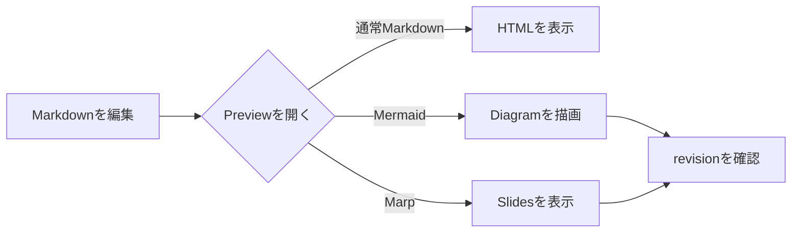
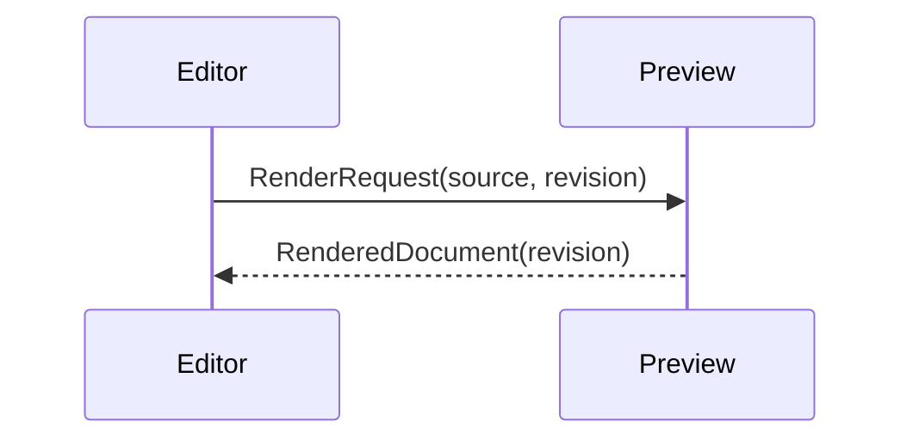

# Mermaid Preview Fixture

この文書は、Mermaid code fenceの検出、描画、theme変更、構文error表示を確認するための正常系fixtureです。

## Flowchart



## Sequence diagram



通常のfenced codeはMermaidとして処理しません。

```text
flowchart LR
    A --> B
```
