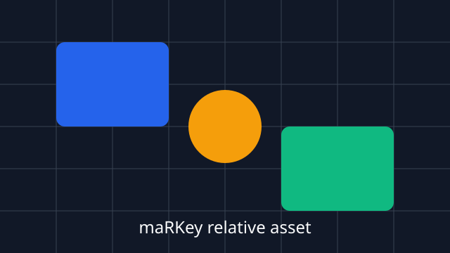

# Mixed Markdown Content

通常のMarkdown要素、Unicode、長い行、相対assetをまとめて確認するfixtureです。

## Inline markup

**bold**、*italic*、~~strikethrough~~、`inline code`、[relative link](small-ja.md)、[external link](https://example.com)を含みます。

> 引用文です。
>
> 二つ目の段落には日本語とEnglishが混在します。

## Lists

- unordered item
  - nested item
- [ ] unchecked task
- [x] checked task

1. first item
2. second item
3. 三番目の項目

## Table

| Feature | Status | Note |
|---|:---:|---|
| Japanese IME | pending | 日本語入力 |
| Mermaid | pending | diagram preview |
| Marp | pending | slide preview |

## Unicode

- Precomposed: café
- Combining sequence: café
- Emoji: 😀 🚀 📝
- ZWJ sequence: 👨‍👩‍👧‍👦
- Flags: 🇯🇵 🇺🇸
- Full-width and half-width: ＡＢＣ ABC １２３ 123

## Long line

This is one intentionally long line used to check horizontal layout, selection, wrapping, and scrolling behavior in the editor. It contains English text, 日本語の文章, inline `code`, numbers 0123456789, punctuation !?., and repeated segments: alpha-beta-gamma / alpha-beta-gamma / alpha-beta-gamma / alpha-beta-gamma / alpha-beta-gamma.

## Code fence

```rust
fn heading_like_text() {
    println!("# This is not a Markdown heading");
}
```

```text
## This is also not a Markdown heading
```

## Relative asset



---

End of fixture.
